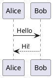

# PlantUML

Zeichnet UML- und andere Diagramme aus PlantUML-Text in einem Codeblock, auf Ihrem Rechner oder auf Wunsch vom PlantUML-Server.

Schreiben Sie einen Codeblock mit der Sprache `plantuml` und setzen Sie PlantUML-Text hinein, von `@startuml` bis `@enduml`. Das Diagramm erscheint unter dem Block; ein Klick in den Block zeigt den Quelltext wieder zum Bearbeiten.

- Sequenz-, Klassen-, Aktivitäts-, Zustands-, Komponenten- und die übrigen PlantUML-Diagramme zeichnet PlantUML selbst, kompiliert für Textus.
- `height=400` hinter der Sprache legt die Höhe des Diagramms in Pixeln fest.
- Auf Ihrem Rechner gezeichnet, folgt das Diagramm dem hellen oder dunklen Aussehen Ihres Themes.
- Lässt sich der Text nicht zeichnen, sagt der Block, was nicht stimmt.
- Beim Export als HTML, PDF oder Word kommt das Diagramm als Bild mit.

**Einstellungen › Erweiterungen › Plugins › PlantUML › Gezeichnet von** legt fest, wo gezeichnet wird:

- **Diesem Rechner** (Standard): Nichts verlässt ihn. Das Zeichnen auf Ihrem Rechner braucht mehr Arbeitsspeicher.
- **PlantUML-Server**: Der Text jedes Diagramms geht an plantuml.com, das es zeichnet. Das braucht keinen zusätzlichen Speicher.

Das Plugin fragt nur nach Netzwerkzugriff auf `www.plantuml.com` und nutzt ihn nur, wenn Sie den PlantUML-Server wählen. Es läuft auf dem Desktop sowie auf iPhone und iPad.

## Beispiel

## Änderungen

- **0.2.7** - Its page no longer says which devices it runs on: the store shows that. It no longer gives a figure for the memory drawing on your computer takes.
- **0.2.6** - Its package lists the libraries it carries, with their licenses.
- **0.2.5** - A chart drawn while its block was folded (a phone) fits once the block opens, instead of keeping its old size.
- **0.2.4** - `!theme` works; no empty gap in a narrow column; server mode shows PlantUML's own error and draws dark in dark themes.
- **0.2.3** - Shorter help and empty-state text.
- **0.2.2** - Its page now says in one sentence what it does, what it can do, and what changed in each version.
- **0.2.1** - Ships the updated shared chart page; diagrams are drawn as before.
- **0.2.0** - Ships the shared chart page that takes its colors from the theme. Needs Textus 1.3.2.
- **0.1.3** - Uses the theme's document text color and footnote size under their Textus 1.3 names.
- **0.1.2** - Drawings from the PlantUML server show again; says that drawing on your computer takes about 100 MB more memory.
- **0.1.0-0.1.1** - First versions: `plantuml` code blocks drawn on your computer or by the PlantUML server, `height=`, and exports as a picture.
