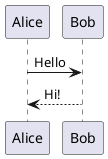

# PlantUML

UML- und andere Diagramme aus PlantUML-Text, auf Ihrem Rechner gezeichnet – oder auf Wunsch vom PlantUML-Server.

- Schreiben Sie einen Codeblock in `plantuml`: Er wird darunter gezeichnet, und seine Quelle erscheint wieder, wenn Sie hineinklicken.
- `height=400` nach der Sprache legt die Höhe der Zeichnung fest.
- Beim Export nach HTML, PDF oder Word kommt die Zeichnung als Bild mit.
- Einstellungen › Plugins › PlantUML › Gezeichnet von: diesem Rechner (Standard, nichts verlässt ihn) oder dem PlantUML-Server.

## Beispiel

