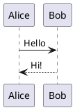

# PlantUML

Zeichnet UML- und andere Diagramme aus PlantUML-Text in einem Codeblock, auf Ihrem Rechner oder auf Wunsch vom PlantUML-Server.

Schreiben Sie einen Codeblock mit der Sprache `plantuml` und setzen Sie PlantUML-Text hinein, von `@startuml` bis `@enduml`. Das Diagramm erscheint unter dem Block; ein Klick in den Block zeigt den Quelltext wieder zum Bearbeiten.

- Sequenz-, Klassen-, Aktivitäts-, Zustands-, Komponenten- und die übrigen PlantUML-Diagramme zeichnet PlantUML selbst, kompiliert für Textus.
- `height=400` hinter der Sprache legt die Höhe des Diagramms in Pixeln fest.
- Auf Ihrem Rechner gezeichnet, folgt das Diagramm dem hellen oder dunklen Aussehen Ihres Themes.
- Lässt sich der Text nicht zeichnen, sagt der Block, was nicht stimmt.
- Beim Export als HTML, PDF oder Word kommt das Diagramm als Bild mit.

**Einstellungen › Erweiterungen › Plugins › PlantUML › Gezeichnet von** legt fest, wo gezeichnet wird:

- **Diesem Rechner** (Standard): Nichts verlässt ihn. Das Zeichnen auf Ihrem Rechner braucht etwa 100 MB mehr Arbeitsspeicher.
- **PlantUML-Server**: Der Text jedes Diagramms geht an plantuml.com, das es zeichnet. Das braucht keinen zusätzlichen Speicher.

Das Plugin fragt nur nach Netzwerkzugriff auf `www.plantuml.com` und nutzt ihn nur, wenn Sie den PlantUML-Server wählen. Es läuft auf dem Desktop sowie auf iPhone und iPad.

## Beispiel

## Änderungen

- **0.2.3** - Kürzere Hilfe- und Leertexte.
- **0.2.2** - Seine Seite sagt jetzt in einem Satz, was es tut, was es kann und was sich in jeder Version geändert hat.
- **0.2.1** - Enthält die aktualisierte gemeinsame Diagrammseite; Diagramme werden wie bisher gezeichnet.
- **0.2.0** - Enthält die gemeinsame Diagrammseite, die ihre Farben aus dem Theme nimmt. Benötigt Textus 1.3.2.
- **0.1.3** - Liest Textfarbe und Fußnotengröße des Dokuments unter ihren Namen aus Textus 1.3.
- **0.1.2** - Zeichnungen vom PlantUML-Server erscheinen wieder; nennt die etwa 100 MB zusätzlichen Arbeitsspeicher beim Zeichnen auf Ihrem Rechner.
- **0.1.0-0.1.1** - Erste Versionen: `plantuml`-Codeblöcke auf Ihrem Rechner oder vom PlantUML-Server gezeichnet, `height=` und Export als Bild.
