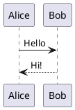

# PlantUML

Diagramas UML y otros a partir de texto PlantUML, dibujados en tu equipo o, si lo eliges, por el servidor de PlantUML.

- Escribe un bloque de código en `plantuml`: se dibuja debajo, y su código vuelve a verse al hacer clic en él.
- `height=400` tras el lenguaje fija la altura del dibujo.
- Al exportar a HTML, PDF o Word, el dibujo va como imagen.
- Ajustes › Extensiones › Plugins › PlantUML › Dibujado por: este equipo (por defecto, nada sale) o el servidor de PlantUML.
- Dibujar en tu ordenador usa unos 100 MB más de memoria; el servidor de PlantUML no usa ninguno.

## Ejemplo

