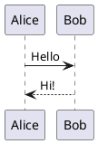

# PlantUML

Dibuja diagramas UML y de otros tipos a partir de texto PlantUML en un bloque de código, en tu equipo o, si lo eliges, en el servidor de PlantUML.

Escribe un bloque de código con el lenguaje `plantuml` y pon dentro texto PlantUML, de `@startuml` a `@enduml`. El diagrama se dibuja debajo del bloque; haz clic en el bloque para ver y editar de nuevo su código.

- Los diagramas de secuencia, de clases, de actividad, de estados, de componentes y los demás de PlantUML los dibuja el propio PlantUML, compilado para funcionar dentro de Textus.
- Escribe `height=400` después del lenguaje para fijar la altura del diagrama en píxeles.
- Dibujado en tu equipo, el diagrama sigue el aspecto claro u oscuro de tu tema.
- Si el texto no se puede dibujar, el bloque dice qué falló.
- Al exportar a HTML, PDF o Word, el diagrama va como imagen.

**Ajustes › Extensiones › Complementos › PlantUML › Dibujado por** elige dónde se dibujan los diagramas:

- **Este equipo** (por defecto): nada sale de él. Dibujar en tu equipo usa unos 100 MB más de memoria.
- **Servidor de PlantUML**: el texto de cada diagrama se envía a plantuml.com, que lo dibuja. No usa memoria extra.

El plugin pide acceso a la red solo para `www.plantuml.com`, y solo lo usa si eliges el servidor de PlantUML. Funciona en el escritorio y en iPhone y iPad.

## Ejemplo

## Cambios

- **0.2.1** - Incluye la página de gráficos compartida actualizada; los diagramas se dibujan igual que antes.
- **0.2.0** - Incluye la página de gráficos compartida que toma los colores del tema. Requiere Textus 1.3.2.
- **0.1.3** - Usa el color del texto del documento y el tamaño de las notas al pie del tema con sus nombres de Textus 1.3.
- **0.1.2** - Los dibujos del servidor de PlantUML vuelven a verse; indica que dibujar en tu equipo usa unos 100 MB más de memoria.
- **0.1.0-0.1.1** - Primeras versiones: bloques `plantuml` dibujados en tu equipo o por el servidor de PlantUML, `height=` y exportación como imagen.
