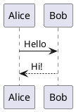

# PlantUML

Dibuja diagramas UML y de otros tipos a partir de texto PlantUML en un bloque de código, en tu equipo o, si lo eliges, en el servidor de PlantUML.

Escribe un bloque de código con el lenguaje `plantuml` y pon dentro texto PlantUML, de `@startuml` a `@enduml`. El diagrama se dibuja debajo del bloque; haz clic en el bloque para ver y editar de nuevo su código.

- Los diagramas de secuencia, de clases, de actividad, de estados, de componentes y los demás de PlantUML los dibuja el propio PlantUML, compilado para funcionar dentro de Textus.
- Escribe `height=400` después del lenguaje para fijar la altura del diagrama en píxeles.
- Dibujado en tu equipo, el diagrama sigue el aspecto claro u oscuro de tu tema.
- Si el texto no se puede dibujar, el bloque dice qué falló.
- Al exportar a HTML, PDF o Word, el diagrama va como imagen.

**Ajustes › Extensiones › Complementos › PlantUML › Dibujado por** elige dónde se dibujan los diagramas:

- **Este equipo** (por defecto): nada sale de él. Dibujar en tu equipo usa más memoria.
- **Servidor de PlantUML**: el texto de cada diagrama se envía a plantuml.com, que lo dibuja. No usa memoria extra.

El plugin pide acceso a la red solo para `www.plantuml.com`, y solo lo usa si eliges el servidor de PlantUML.

## Ejemplo

## Cambios

- **0.2.7** - Its page no longer says which devices it runs on: the store shows that. It no longer gives a figure for the memory drawing on your computer takes.
- **0.2.6** - Its package lists the libraries it carries, with their licenses.
- **0.2.5** - A chart drawn while its block was folded (a phone) fits once the block opens, instead of keeping its old size.
- **0.2.4** - `!theme` works; no empty gap in a narrow column; server mode shows PlantUML's own error and draws dark in dark themes.
- **0.2.3** - Shorter help and empty-state text.
- **0.2.2** - Its page now says in one sentence what it does, what it can do, and what changed in each version.
- **0.2.1** - Ships the updated shared chart page; diagrams are drawn as before.
- **0.2.0** - Ships the shared chart page that takes its colors from the theme. Needs Textus 1.3.2.
- **0.1.3** - Uses the theme's document text color and footnote size under their Textus 1.3 names.
- **0.1.2** - Drawings from the PlantUML server show again; says that drawing on your computer takes about 100 MB more memory.
- **0.1.0-0.1.1** - First versions: `plantuml` code blocks drawn on your computer or by the PlantUML server, `height=`, and exports as a picture.
