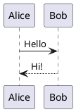

# PlantUML

Dessine des diagrammes UML et d’autres à partir de texte PlantUML dans un bloc de code, sur votre ordinateur ou, au choix, par le serveur PlantUML.

Écrivez un bloc de code avec le langage `plantuml` et mettez-y du texte PlantUML, de `@startuml` à `@enduml`. Le diagramme est dessiné sous le bloc ; cliquez dans le bloc pour revoir et modifier sa source.

- Diagrammes de séquence, de classes, d’activité, d’états, de composants et les autres diagrammes PlantUML sont dessinés par PlantUML lui-même, compilé pour tourner dans Textus.
- Écrivez `height=400` après le langage pour fixer la hauteur du diagramme en pixels.
- Dessiné sur votre ordinateur, le diagramme suit l’apparence claire ou sombre de votre thème.
- Si le texte ne peut pas être dessiné, le bloc indique ce qui ne va pas.
- Un export en HTML, PDF ou Word contient le diagramme sous forme d’image.

**Réglages › Extensions › Modules › PlantUML › Dessiné par** choisit où les diagrammes sont dessinés :

- **Cet ordinateur** (par défaut) : rien n’en sort. Dessiner sur votre ordinateur prend environ 100 Mo de mémoire en plus.
- **Serveur PlantUML** : le texte de chaque diagramme est envoyé à plantuml.com, qui le dessine. Pas de mémoire en plus.

Le plugin demande l’accès au réseau pour `www.plantuml.com` seulement, et ne s’en sert que si vous choisissez le serveur PlantUML. Il fonctionne sur ordinateur, iPhone et iPad.

## Exemple

## Changements

- **0.2.3** - Textes d'aide et d'état vide plus courts.
- **0.2.2** - Sa page dit maintenant en une phrase ce qu'il fait, ce qu'il permet et ce qui a changé à chaque version.
- **0.2.1** - Contient la page de graphiques partagée mise à jour ; les diagrammes sont dessinés comme avant.
- **0.2.0** - Contient la page de graphiques partagée qui prend ses couleurs dans le thème. Nécessite Textus 1.3.2.
- **0.1.3** - Utilise la couleur du texte du document et la taille des notes de bas de page du thème sous leurs noms de Textus 1.3.
- **0.1.2** - Les dessins du serveur PlantUML s’affichent de nouveau ; indique que dessiner sur votre ordinateur prend environ 100 Mo de mémoire en plus.
- **0.1.0-0.1.1** - Premières versions : blocs `plantuml` dessinés sur votre ordinateur ou par le serveur PlantUML, `height=` et export en image.
