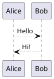

# PlantUML

Diagrammes UML et autres à partir de texte PlantUML, dessinés sur votre ordinateur ou, au choix, par le serveur PlantUML.

- Écrivez un bloc de code en `plantuml` : il est dessiné en dessous, et sa source réapparaît quand vous cliquez dedans.
- `height=400` après le langage fixe la hauteur du dessin.
- À l’export en HTML, PDF ou Word, le dessin devient une image.
- Réglages › Extensions › Plugins › PlantUML › Dessiné par : cet ordinateur (par défaut, rien n’en sort) ou le serveur PlantUML.
- Dessiner sur votre ordinateur prend environ 100 Mo de mémoire en plus ; le serveur PlantUML n’en prend pas.

## Exemple

