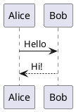

# PlantUML

Dessine des diagrammes UML et d’autres à partir de texte PlantUML dans un bloc de code, sur votre ordinateur ou, au choix, par le serveur PlantUML.

Écrivez un bloc de code avec le langage `plantuml` et mettez-y du texte PlantUML, de `@startuml` à `@enduml`. Le diagramme est dessiné sous le bloc ; cliquez dans le bloc pour revoir et modifier sa source.

- Diagrammes de séquence, de classes, d’activité, d’états, de composants et les autres diagrammes PlantUML sont dessinés par PlantUML lui-même, compilé pour tourner dans Textus.
- Écrivez `height=400` après le langage pour fixer la hauteur du diagramme en pixels.
- Dessiné sur votre ordinateur, le diagramme suit l’apparence claire ou sombre de votre thème.
- Si le texte ne peut pas être dessiné, le bloc indique ce qui ne va pas.
- Un export en HTML, PDF ou Word contient le diagramme sous forme d’image.

**Réglages › Extensions › Modules › PlantUML › Dessiné par** choisit où les diagrammes sont dessinés :

- **Cet ordinateur** (par défaut) : rien n’en sort. Dessiner sur votre ordinateur prend plus de mémoire.
- **Serveur PlantUML** : le texte de chaque diagramme est envoyé à plantuml.com, qui le dessine. Pas de mémoire en plus.

Le plugin demande l’accès au réseau pour `www.plantuml.com` seulement, et ne s’en sert que si vous choisissez le serveur PlantUML.

## Exemple

## Changements

- **0.2.8** - A simpler icon, drawn in the text colour.
- **0.2.7** - Its page no longer says which devices it runs on: the store shows that. It no longer gives a figure for the memory drawing on your computer takes.
- **0.2.6** - Its package lists the libraries it carries, with their licenses.
- **0.2.5** - A chart drawn while its block was folded (a phone) fits once the block opens, instead of keeping its old size.
- **0.2.4** - `!theme` works; no empty gap in a narrow column; server mode shows PlantUML's own error and draws dark in dark themes.
- **0.2.3** - Shorter help and empty-state text.
- **0.2.2** - Its page now says in one sentence what it does, what it can do, and what changed in each version.
- **0.2.1** - Ships the updated shared chart page; diagrams are drawn as before.
- **0.2.0** - Ships the shared chart page that takes its colors from the theme. Needs Textus 1.3.2.
- **0.1.3** - Uses the theme's document text color and footnote size under their Textus 1.3 names.
- **0.1.2** - Drawings from the PlantUML server show again; says that drawing on your computer takes about 100 MB more memory.
- **0.1.0-0.1.1** - First versions: `plantuml` code blocks drawn on your computer or by the PlantUML server, `height=`, and exports as a picture.
