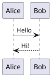

# PlantUML

コードブロックに書いた PlantUML のテキストから UML などの図を描きます。描くのはこのコンピュータ、選べば PlantUML サーバーです。

言語を `plantuml` にしたコードブロックに、`@startuml` から `@enduml` までの PlantUML のテキストを書きます。図はブロックの下に描かれ、ブロックをクリックするとソースをもう一度表示して編集できます。

- シーケンス図、クラス図、アクティビティ図、状態図、コンポーネント図など、PlantUML の図は Textus の中で動くようにコンパイルされた PlantUML 自身が描きます。
- 言語の後に `height=400` と書くと、図の高さをピクセルで指定できます。
- このコンピュータで描く場合、図はテーマのライト・ダークに合わせます。
- テキストを描けないときは、何が問題かをブロックに表示します。
- HTML・PDF・Word に書き出すと、図は画像として入ります。

**設定 › 拡張機能 › プラグイン › PlantUML › 描画する場所** で、図を描く場所を選びます：

- **このコンピュータ**（既定）：内容は外に出ません。このコンピュータで描くとメモリを約 100 MB 余分に使います。
- **PlantUML サーバー**：各図のテキストが plantuml.com に送られ、そこで描かれます。余分なメモリは使いません。

このプラグインが求めるのは `www.plantuml.com` へのネットワーク接続だけで、PlantUML サーバーを選んだときにしか使いません。デスクトップと iPhone・iPad で使えます。

## 例

## 更新履歴

- **0.2.3** - 説明と空の状態の文言を短くしました。
- **0.2.2** - 紹介ページを書き直しました。何をするかを一文で示し、できることと各バージョンの変更を載せています。
- **0.2.1** - 更新された共通のグラフページを同梱。描画はこれまでどおりです。
- **0.2.0** - テーマから色を取る共通のグラフページを同梱。Textus 1.3.2 が必要です。
- **0.1.3** - テーマの本文の文字色と脚注のサイズを Textus 1.3 の新しい名前で読みます。
- **0.1.2** - PlantUML サーバーの図がまた表示されるように。このコンピュータで描くとメモリを約 100 MB 余分に使うことを明記。
- **0.1.0-0.1.1** - 最初のバージョン：`plantuml` コードブロックをこのコンピュータか PlantUML サーバーで描画、`height=`、書き出しでは画像に。
