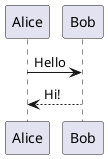

# PlantUML

コードブロックに書いた PlantUML のテキストから UML などの図を描きます。描くのはこのコンピュータ、選べば PlantUML サーバーです。

言語を `plantuml` にしたコードブロックに、`@startuml` から `@enduml` までの PlantUML のテキストを書きます。図はブロックの下に描かれ、ブロックをクリックするとソースをもう一度表示して編集できます。

- シーケンス図、クラス図、アクティビティ図、状態図、コンポーネント図など、PlantUML の図は Textus の中で動くようにコンパイルされた PlantUML 自身が描きます。
- 言語の後に `height=400` と書くと、図の高さをピクセルで指定できます。
- このコンピュータで描く場合、図はテーマのライト・ダークに合わせます。
- テキストを描けないときは、何が問題かをブロックに表示します。
- HTML・PDF・Word に書き出すと、図は画像として入ります。

**設定 › 拡張機能 › プラグイン › PlantUML › 描画する場所** で、図を描く場所を選びます：

- **このコンピュータ**（既定）：内容は外に出ません。このコンピュータで描くとメモリを多めに使います。
- **PlantUML サーバー**：各図のテキストが plantuml.com に送られ、そこで描かれます。余分なメモリは使いません。

このプラグインが求めるのは `www.plantuml.com` へのネットワーク接続だけで、PlantUML サーバーを選んだときにしか使いません。

## 例

## 更新履歴

- **0.2.7** - Its page no longer says which devices it runs on: the store shows that. It no longer gives a figure for the memory drawing on your computer takes.
- **0.2.6** - Its package lists the libraries it carries, with their licenses.
- **0.2.5** - A chart drawn while its block was folded (a phone) fits once the block opens, instead of keeping its old size.
- **0.2.4** - `!theme` works; no empty gap in a narrow column; server mode shows PlantUML's own error and draws dark in dark themes.
- **0.2.3** - Shorter help and empty-state text.
- **0.2.2** - Its page now says in one sentence what it does, what it can do, and what changed in each version.
- **0.2.1** - Ships the updated shared chart page; diagrams are drawn as before.
- **0.2.0** - Ships the shared chart page that takes its colors from the theme. Needs Textus 1.3.2.
- **0.1.3** - Uses the theme's document text color and footnote size under their Textus 1.3 names.
- **0.1.2** - Drawings from the PlantUML server show again; says that drawing on your computer takes about 100 MB more memory.
- **0.1.0-0.1.1** - First versions: `plantuml` code blocks drawn on your computer or by the PlantUML server, `height=`, and exports as a picture.
