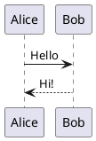

# PlantUML

PlantUML のテキストから UML などの図を描きます。既定はこのコンピュータで描画し、PlantUML サーバーも選べます。

- `plantuml` のコードブロックを書くと、その下に描かれます。ブロックをクリックするとソースが表示され、編集できます。
- 言語名の後に `height=400` と書くと高さを指定できます。
- HTML・PDF・Word に書き出すと、図は画像として入ります。
- 設定 › プラグイン › PlantUML › 描画する場所：このコンピュータ（既定・内容は外に出ません）または PlantUML サーバー。

## 例

