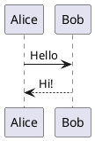

# PlantUML

코드 블록에 쓴 PlantUML 텍스트로 UML 등 다이어그램을 그립니다. 이 컴퓨터에서 그리거나, 원하면 PlantUML 서버가 그립니다.

언어를 `plantuml`로 한 코드 블록에 `@startuml`부터 `@enduml`까지 PlantUML 텍스트를 씁니다. 다이어그램은 블록 아래에 그려지고, 블록을 클릭하면 소스를 다시 보고 고칠 수 있습니다.

- 시퀀스, 클래스, 액티비티, 상태, 컴포넌트 등 PlantUML 다이어그램은 Textus 안에서 돌도록 컴파일된 PlantUML이 직접 그립니다.
- 언어 뒤에 `height=400`처럼 쓰면 다이어그램 높이를 픽셀로 정합니다.
- 이 컴퓨터에서 그리면 다이어그램이 테마의 라이트·다크 모양을 따릅니다.
- 텍스트를 그릴 수 없으면 무엇이 문제인지 블록에 표시합니다.
- HTML, PDF, Word로 내보내면 다이어그램이 그림으로 들어갑니다.

**설정 › 확장 › 플러그인 › PlantUML › 그리는 곳**에서 그릴 곳을 고릅니다:

- **이 컴퓨터**(기본값): 내용이 밖으로 나가지 않습니다. 이 컴퓨터에서 그리면 메모리를 더 씁니다.
- **PlantUML 서버**: 각 다이어그램의 텍스트를 plantuml.com에 보내 그곳에서 그립니다. 메모리를 더 쓰지 않습니다.

이 플러그인은 `www.plantuml.com`에 대한 네트워크 권한만 요청하며, PlantUML 서버를 골랐을 때만 씁니다.

## 예시

## 변경 내역

- **0.2.7** - Its page no longer says which devices it runs on: the store shows that. It no longer gives a figure for the memory drawing on your computer takes. Its page receives Textus's messages by the API's current name.
- **0.2.6** - Its package lists the libraries it carries, with their licenses.
- **0.2.5** - A chart drawn while its block was folded (a phone) fits once the block opens, instead of keeping its old size.
- **0.2.4** - `!theme` works; no empty gap in a narrow column; server mode shows PlantUML's own error and draws dark in dark themes.
- **0.2.3** - Shorter help and empty-state text.
- **0.2.2** - Its page now says in one sentence what it does, what it can do, and what changed in each version.
- **0.2.1** - Ships the updated shared chart page; diagrams are drawn as before.
- **0.2.0** - Ships the shared chart page that takes its colors from the theme. Needs Textus 1.3.2.
- **0.1.3** - Uses the theme's document text color and footnote size under their Textus 1.3 names.
- **0.1.2** - Drawings from the PlantUML server show again; says that drawing on your computer takes about 100 MB more memory.
- **0.1.0-0.1.1** - First versions: `plantuml` code blocks drawn on your computer or by the PlantUML server, `height=`, and exports as a picture.
