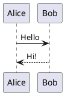

# PlantUML

코드 블록에 쓴 PlantUML 텍스트로 UML 등 다이어그램을 그립니다. 이 컴퓨터에서 그리거나, 원하면 PlantUML 서버가 그립니다.

언어를 `plantuml`로 한 코드 블록에 `@startuml`부터 `@enduml`까지 PlantUML 텍스트를 씁니다. 다이어그램은 블록 아래에 그려지고, 블록을 클릭하면 소스를 다시 보고 고칠 수 있습니다.

- 시퀀스, 클래스, 액티비티, 상태, 컴포넌트 등 PlantUML 다이어그램은 Textus 안에서 돌도록 컴파일된 PlantUML이 직접 그립니다.
- 언어 뒤에 `height=400`처럼 쓰면 다이어그램 높이를 픽셀로 정합니다.
- 이 컴퓨터에서 그리면 다이어그램이 테마의 라이트·다크 모양을 따릅니다.
- 텍스트를 그릴 수 없으면 무엇이 문제인지 블록에 표시합니다.
- HTML, PDF, Word로 내보내면 다이어그램이 그림으로 들어갑니다.

**설정 › 확장 › 플러그인 › PlantUML › 그리는 곳**에서 그릴 곳을 고릅니다:

- **이 컴퓨터**(기본값): 내용이 밖으로 나가지 않습니다. 이 컴퓨터에서 그리면 메모리를 약 100MB 더 씁니다.
- **PlantUML 서버**: 각 다이어그램의 텍스트를 plantuml.com에 보내 그곳에서 그립니다. 메모리를 더 쓰지 않습니다.

이 플러그인은 `www.plantuml.com`에 대한 네트워크 권한만 요청하며, PlantUML 서버를 골랐을 때만 씁니다. 데스크톱과 iPhone, iPad에서 쓸 수 있습니다.

## 예시

## 변경 내역

- **0.2.3** - 설명과 빈 상태 문구를 짧게 줄였습니다.
- **0.2.2** - 소개 페이지를 새로 썼습니다. 무엇을 하는지 한 문장으로, 할 수 있는 일과 버전별 변경 내역을 담았습니다.
- **0.2.1** - 업데이트된 공용 차트 페이지를 함께 담음. 그리는 방식은 그대로입니다.
- **0.2.0** - 테마에서 색을 가져오는 공용 차트 페이지를 함께 담음. Textus 1.3.2가 필요합니다.
- **0.1.3** - 테마의 본문 글자색과 각주 크기를 Textus 1.3의 새 이름으로 읽습니다.
- **0.1.2** - PlantUML 서버가 그린 그림이 다시 보입니다. 이 컴퓨터에서 그리면 메모리를 약 100MB 더 쓴다고 안내합니다.
- **0.1.0-0.1.1** - 첫 버전들: `plantuml` 코드 블록을 이 컴퓨터나 PlantUML 서버에서 그리기, `height=`, 내보낼 때 그림으로.
