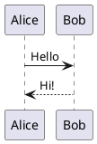

# PlantUML

PlantUML 텍스트로 UML 등 다이어그램을 그립니다. 기본은 이 컴퓨터에서 그리고, PlantUML 서버도 고를 수 있습니다.

- `plantuml` 코드 블록을 쓰면 그 아래에 그려집니다. 블록을 클릭하면 소스가 다시 보이고 고칠 수 있습니다.
- 언어 이름 뒤에 `height=400`을 쓰면 높이를 정할 수 있습니다.
- HTML, PDF, Word로 내보내면 그림이 이미지로 들어갑니다.
- 설정 › 플러그인 › PlantUML › 그리는 곳: 이 컴퓨터(기본값, 내용이 나가지 않음) 또는 PlantUML 서버.

## 예시

