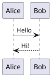

# PlantUML

Draw UML and other diagrams from PlantUML text in a code block, on your computer or, if you choose, by the PlantUML server.

Write a code block with the language `plantuml` and put PlantUML text in it, from `@startuml` to `@enduml`. The diagram is drawn below the block; click into the block to see and edit its source again.

- Sequence, class, activity, state, component and the other PlantUML diagrams are drawn by PlantUML itself, compiled to run inside Textus.
- Write `height=400` after the language to set the diagram's height in pixels.
- Drawn on your computer, the diagram follows your theme's light or dark look.
- If the text can't be drawn, the block says what went wrong.
- An export to HTML, PDF or Word carries the diagram as a picture.

**Settings › Extensions › Plugins › PlantUML › Drawn by** chooses where diagrams are drawn:

- **This computer** (the default): nothing leaves it. Drawing on your computer takes about 100 MB more memory.
- **PlantUML server**: each diagram's text is sent to plantuml.com, which draws it. This takes no extra memory.

The plugin asks for network access to `www.plantuml.com` only, and uses it only when you choose the PlantUML server. It works on the desktop and on iPhone and iPad.

## Example

## Changes

- **0.2.3** - Shorter help and empty-state text.
- **0.2.2** - Its page now says in one sentence what it does, what it can do, and what changed in each version.
- **0.2.1** - Ships the updated shared chart page; diagrams are drawn as before.
- **0.2.0** - Ships the shared chart page that takes its colors from the theme. Needs Textus 1.3.2.
- **0.1.3** - Uses the theme's document text color and footnote size under their Textus 1.3 names.
- **0.1.2** - Drawings from the PlantUML server show again; says that drawing on your computer takes about 100 MB more memory.
- **0.1.0-0.1.1** - First versions: `plantuml` code blocks drawn on your computer or by the PlantUML server, `height=`, and exports as a picture.
