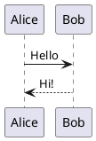

# PlantUML

UML and other diagrams from PlantUML text, drawn on your computer - or by the PlantUML server, if you choose.

- Write a code block in `plantuml`: it is drawn below, and its source shows again when you click into it.
- `height=400` after the language sets the drawing's height.
- An export - HTML, PDF, Word - carries the drawing as a picture.
- Settings › Extensions › Plugins › PlantUML › Drawn by: this computer (the default - nothing leaves it) or the PlantUML server.
- Drawing on your computer takes about 100 MB more memory; the PlantUML server takes none.

## Example

