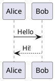

# PlantUML

Desenha diagramas UML e outros a partir de texto PlantUML num bloco de código, no seu computador ou, se preferir, pelo servidor do PlantUML.

Escreva um bloco de código com a linguagem `plantuml` e coloque nele texto PlantUML, de `@startuml` a `@enduml`. O diagrama é desenhado abaixo do bloco; clique no bloco para ver e editar o código de novo.

- Diagramas de sequência, de classes, de atividade, de estados, de componentes e os outros do PlantUML são desenhados pelo próprio PlantUML, compilado para rodar dentro do Textus.
- Escreva `height=400` depois da linguagem para definir a altura do diagrama em pixels.
- Desenhado no seu computador, o diagrama segue a aparência clara ou escura do seu tema.
- Se o texto não puder ser desenhado, o bloco diz o que deu errado.
- Ao exportar para HTML, PDF ou Word, o diagrama vai como imagem.

**Ajustes › Extensões › Plugins › PlantUML › Desenhado por** escolhe onde os diagramas são desenhados:

- **Este computador** (padrão): nada sai dele. Desenhar no seu computador usa mais memória.
- **Servidor do PlantUML**: o texto de cada diagrama vai para plantuml.com, que o desenha. Não usa memória a mais.

O plugin pede acesso à rede só para `www.plantuml.com`, e só o usa quando você escolhe o servidor do PlantUML.

## Exemplo

## Alterações

- **0.2.7** - Its page no longer says which devices it runs on: the store shows that. It no longer gives a figure for the memory drawing on your computer takes.
- **0.2.6** - Its package lists the libraries it carries, with their licenses.
- **0.2.5** - A chart drawn while its block was folded (a phone) fits once the block opens, instead of keeping its old size.
- **0.2.4** - `!theme` works; no empty gap in a narrow column; server mode shows PlantUML's own error and draws dark in dark themes.
- **0.2.3** - Shorter help and empty-state text.
- **0.2.2** - Its page now says in one sentence what it does, what it can do, and what changed in each version.
- **0.2.1** - Ships the updated shared chart page; diagrams are drawn as before.
- **0.2.0** - Ships the shared chart page that takes its colors from the theme. Needs Textus 1.3.2.
- **0.1.3** - Uses the theme's document text color and footnote size under their Textus 1.3 names.
- **0.1.2** - Drawings from the PlantUML server show again; says that drawing on your computer takes about 100 MB more memory.
- **0.1.0-0.1.1** - First versions: `plantuml` code blocks drawn on your computer or by the PlantUML server, `height=`, and exports as a picture.
