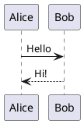

# PlantUML

Desenha diagramas UML e outros a partir de texto PlantUML num bloco de código, no seu computador ou, se preferir, pelo servidor do PlantUML.

Escreva um bloco de código com a linguagem `plantuml` e coloque nele texto PlantUML, de `@startuml` a `@enduml`. O diagrama é desenhado abaixo do bloco; clique no bloco para ver e editar o código de novo.

- Diagramas de sequência, de classes, de atividade, de estados, de componentes e os outros do PlantUML são desenhados pelo próprio PlantUML, compilado para rodar dentro do Textus.
- Escreva `height=400` depois da linguagem para definir a altura do diagrama em pixels.
- Desenhado no seu computador, o diagrama segue a aparência clara ou escura do seu tema.
- Se o texto não puder ser desenhado, o bloco diz o que deu errado.
- Ao exportar para HTML, PDF ou Word, o diagrama vai como imagem.

**Ajustes › Extensões › Plugins › PlantUML › Desenhado por** escolhe onde os diagramas são desenhados:

- **Este computador** (padrão): nada sai dele. Desenhar no seu computador usa cerca de 100 MB a mais de memória.
- **Servidor do PlantUML**: o texto de cada diagrama vai para plantuml.com, que o desenha. Não usa memória a mais.

O plugin pede acesso à rede só para `www.plantuml.com`, e só o usa quando você escolhe o servidor do PlantUML. Funciona no computador, no iPhone e no iPad.

## Exemplo

## Alterações

- **0.2.4** - `!theme` funciona; sem espaço vazio numa coluna estreita; no modo servidor aparece o erro do próprio PlantUML e os temas escuros têm desenho escuro.
- **0.2.3** - Textos de ajuda e de estado vazio mais curtos.
- **0.2.2** - Sua página agora diz numa frase o que ele faz, o que pode fazer e o que mudou em cada versão.
- **0.2.1** - Traz a página de gráficos compartilhada atualizada; os diagramas são desenhados como antes.
- **0.2.0** - Traz a página de gráficos compartilhada que tira as cores do tema. Requer Textus 1.3.2.
- **0.1.3** - Usa a cor do texto do documento e o tamanho das notas de rodapé do tema pelos nomes do Textus 1.3.
- **0.1.2** - Os desenhos do servidor do PlantUML voltam a aparecer; diz que desenhar no seu computador usa cerca de 100 MB a mais de memória.
- **0.1.0-0.1.1** - Primeiras versões: blocos `plantuml` desenhados no seu computador ou pelo servidor do PlantUML, `height=` e exportação como imagem.
