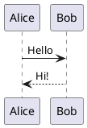

# PlantUML

Diagramas UML e outros a partir de texto PlantUML, desenhados no seu computador ou, se preferir, pelo servidor do PlantUML.

- Escreva um bloco de código em `plantuml`: ele é desenhado abaixo, e o código volta a aparecer ao clicar nele.
- `height=400` depois da linguagem define a altura do desenho.
- Ao exportar para HTML, PDF ou Word, o desenho vai como imagem.
- Ajustes › Extensões › Plugins › PlantUML › Desenhado por: este computador (padrão, nada sai) ou o servidor do PlantUML.
- Desenhar no seu computador usa cerca de 100 MB a mais de memória; o servidor do PlantUML não usa nenhuma.

## Exemplo

