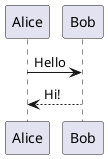

# PlantUML

Рисует UML и другие диаграммы по тексту PlantUML в блоке кода — на вашем компьютере или, по выбору, на сервере PlantUML.

Создайте блок кода с языком `plantuml` и напишите в нём текст PlantUML от `@startuml` до `@enduml`. Диаграмма появится под блоком; щёлкните по блоку, чтобы снова увидеть и изменить исходный текст.

- Диаграммы последовательности, классов, деятельности, состояний, компонентов и другие диаграммы PlantUML рисует сам PlantUML, скомпилированный для работы внутри Textus.
- Напишите `height=400` после названия языка, чтобы задать высоту диаграммы в пикселях.
- Если рисовать на компьютере, диаграмма следует светлому или тёмному виду темы.
- Если текст нарисовать нельзя, блок сообщает, в чём ошибка.
- При экспорте в HTML, PDF или Word диаграмма попадает туда картинкой.

**Настройки › Расширения › Плагины › PlantUML › Чем рисовать** — где рисуются диаграммы:

- **Этот компьютер** (по умолчанию): ничего не уходит наружу. Рисование на компьютере занимает больше памяти.
- **Сервер PlantUML**: текст каждой диаграммы отправляется на plantuml.com, и диаграмму рисует он. Лишней памяти не нужно.

Плагин просит доступ к сети только для `www.plantuml.com` и пользуется им, только если выбран сервер PlantUML.

## Пример

## Изменения

- **0.2.7** - Its page no longer says which devices it runs on: the store shows that. It no longer gives a figure for the memory drawing on your computer takes.
- **0.2.6** - Its package lists the libraries it carries, with their licenses.
- **0.2.5** - A chart drawn while its block was folded (a phone) fits once the block opens, instead of keeping its old size.
- **0.2.4** - `!theme` works; no empty gap in a narrow column; server mode shows PlantUML's own error and draws dark in dark themes.
- **0.2.3** - Shorter help and empty-state text.
- **0.2.2** - Its page now says in one sentence what it does, what it can do, and what changed in each version.
- **0.2.1** - Ships the updated shared chart page; diagrams are drawn as before.
- **0.2.0** - Ships the shared chart page that takes its colors from the theme. Needs Textus 1.3.2.
- **0.1.3** - Uses the theme's document text color and footnote size under their Textus 1.3 names.
- **0.1.2** - Drawings from the PlantUML server show again; says that drawing on your computer takes about 100 MB more memory.
- **0.1.0-0.1.1** - First versions: `plantuml` code blocks drawn on your computer or by the PlantUML server, `height=`, and exports as a picture.
