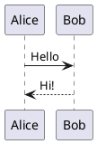

# PlantUML

Рисует UML и другие диаграммы по тексту PlantUML в блоке кода — на вашем компьютере или, по выбору, на сервере PlantUML.

Создайте блок кода с языком `plantuml` и напишите в нём текст PlantUML от `@startuml` до `@enduml`. Диаграмма появится под блоком; щёлкните по блоку, чтобы снова увидеть и изменить исходный текст.

- Диаграммы последовательности, классов, деятельности, состояний, компонентов и другие диаграммы PlantUML рисует сам PlantUML, скомпилированный для работы внутри Textus.
- Напишите `height=400` после названия языка, чтобы задать высоту диаграммы в пикселях.
- Если рисовать на компьютере, диаграмма следует светлому или тёмному виду темы.
- Если текст нарисовать нельзя, блок сообщает, в чём ошибка.
- При экспорте в HTML, PDF или Word диаграмма попадает туда картинкой.

**Настройки › Расширения › Плагины › PlantUML › Чем рисовать** — где рисуются диаграммы:

- **Этот компьютер** (по умолчанию): ничего не уходит наружу. Рисование на компьютере занимает примерно на 100 МБ больше памяти.
- **Сервер PlantUML**: текст каждой диаграммы отправляется на plantuml.com, и диаграмму рисует он. Лишней памяти не нужно.

Плагин просит доступ к сети только для `www.plantuml.com` и пользуется им, только если выбран сервер PlantUML. Работает на компьютере, iPhone и iPad.

## Пример

## Изменения

- **0.2.2** - Его страница теперь одной фразой говорит, что он делает, что умеет и что менялось в каждой версии.
- **0.2.1** - Включает обновлённую общую страницу диаграмм; рисует так же, как раньше.
- **0.2.0** - Включает общую страницу диаграмм, которая берёт цвета из темы. Нужен Textus 1.3.2.
- **0.1.3** - Цвет текста документа и размер сносок из темы читаются под их новыми именами в Textus 1.3.
- **0.1.2** - Рисунки с сервера PlantUML снова видны; указано, что рисование на компьютере занимает примерно на 100 МБ больше памяти.
- **0.1.0-0.1.1** - Первые версии: блоки `plantuml` рисуются на компьютере или сервером PlantUML, `height=`, при экспорте — картинка.
