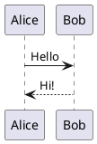

# PlantUML

UML и другие диаграммы по тексту PlantUML — рисуются на вашем компьютере или, по выбору, сервером PlantUML.

- Напишите блок кода на `plantuml`: под ним появится рисунок, а исходник снова видно, если щёлкнуть в блок.
- `height=400` после имени языка задаёт высоту рисунка.
- При экспорте в HTML, PDF или Word рисунок попадает картинкой.
- Настройки › Расширения › Плагины › PlantUML › Чем рисовать: этот компьютер (по умолчанию, ничего не уходит) или сервер PlantUML.
- Рисование на компьютере занимает примерно на 100 МБ больше памяти; сервер PlantUML не занимает ничего.

## Пример

