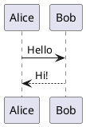

# PlantUML

在程式碼區塊裡用 PlantUML 文字畫 UML 等圖，預設在本機算繪，也可以選擇交給 PlantUML 伺服器。

寫一個語言為 `plantuml` 的程式碼區塊，在裡面寫 PlantUML 文字（從 `@startuml` 到 `@enduml`）。區塊下方會畫出圖；點進區塊可以再次檢視和修改原始碼。

- 循序圖、類別圖、活動圖、狀態圖、元件圖等 PlantUML 圖，都由編譯後在 Textus 裡執行的 PlantUML 本身繪製。
- 在語言後面寫 `height=400` 可以設定圖的高度（單位為像素）。
- 在本機算繪時，圖會跟著佈景主題的淺色或深色外觀。
- 文字畫不出來時，區塊裡會說明哪裡出了問題。
- 匯出 HTML、PDF、Word 時，圖會以圖片放進去。

**設定 › 擴充功能 › 外掛程式 › PlantUML › 算繪方式** 決定在哪裡畫圖：

- **本機**（預設）：內容不會離開電腦。在本機畫圖會多佔一些記憶體。
- **PlantUML 伺服器**：每張圖的文字會傳給 plantuml.com，由它來畫，不額外佔記憶體。

外掛只要求連線到 `www.plantuml.com` 的網路權限，而且只在你選擇 PlantUML 伺服器時才使用。電腦、iPhone 和 iPad 上都能使用。

## 範例

## 更新紀錄

- **0.2.7** - Its page no longer says which devices it runs on: the store shows that. It no longer gives a figure for the memory drawing on your computer takes.
- **0.2.6** - Its package lists the libraries it carries, with their licenses.
- **0.2.5** - A chart drawn while its block was folded (a phone) fits once the block opens, instead of keeping its old size.
- **0.2.4** - `!theme` works; no empty gap in a narrow column; server mode shows PlantUML's own error and draws dark in dark themes.
- **0.2.3** - Shorter help and empty-state text.
- **0.2.2** - Its page now says in one sentence what it does, what it can do, and what changed in each version.
- **0.2.1** - Ships the updated shared chart page; diagrams are drawn as before.
- **0.2.0** - Ships the shared chart page that takes its colors from the theme. Needs Textus 1.3.2.
- **0.1.3** - Uses the theme's document text color and footnote size under their Textus 1.3 names.
- **0.1.2** - Drawings from the PlantUML server show again; says that drawing on your computer takes about 100 MB more memory.
- **0.1.0-0.1.1** - First versions: `plantuml` code blocks drawn on your computer or by the PlantUML server, `height=`, and exports as a picture.
