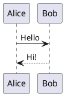

# PlantUML

在程式碼區塊裡用 PlantUML 文字畫 UML 等圖，預設在本機算繪，也可以選擇交給 PlantUML 伺服器。

寫一個語言為 `plantuml` 的程式碼區塊，在裡面寫 PlantUML 文字（從 `@startuml` 到 `@enduml`）。區塊下方會畫出圖；點進區塊可以再次檢視和修改原始碼。

- 循序圖、類別圖、活動圖、狀態圖、元件圖等 PlantUML 圖，都由編譯後在 Textus 裡執行的 PlantUML 本身繪製。
- 在語言後面寫 `height=400` 可以設定圖的高度（單位為像素）。
- 在本機算繪時，圖會跟著佈景主題的淺色或深色外觀。
- 文字畫不出來時，區塊裡會說明哪裡出了問題。
- 匯出 HTML、PDF、Word 時，圖會以圖片放進去。

**設定 › 擴充功能 › 外掛程式 › PlantUML › 算繪方式** 決定在哪裡畫圖：

- **本機**（預設）：內容不會離開電腦。在本機畫圖約多佔 100 MB 記憶體。
- **PlantUML 伺服器**：每張圖的文字會傳給 plantuml.com，由它來畫，不額外佔記憶體。

外掛只要求連線到 `www.plantuml.com` 的網路權限，而且只在你選擇 PlantUML 伺服器時才使用。電腦、iPhone 和 iPad 上都能使用。

## 範例

## 更新紀錄

- **0.2.4** - `!theme` 主題可用；窄欄裡不再留空白；伺服器模式會顯示 PlantUML 自己的錯誤，深色主題下用深色圖。
- **0.2.3** - 說明和空狀態文字更簡短。
- **0.2.2** - 介紹頁重寫：一句話說明它做什麼，再講它能做的事，並列出每個版本的更新。
- **0.2.1** - 打包更新後的共用圖表頁面，繪圖結果不變。
- **0.2.0** - 打包從佈景主題取色的共用圖表頁面。需要 Textus 1.3.2。
- **0.1.3** - 依 Textus 1.3 的新名稱讀取主題的內文文字顏色和註腳字級。
- **0.1.2** - PlantUML 伺服器畫的圖重新能顯示；說明在本機畫圖約多佔 100 MB 記憶體。
- **0.1.0-0.1.1** - 最初的版本：在本機或由 PlantUML 伺服器繪製 `plantuml` 區塊，支援 `height=`，匯出時以圖片呈現。
