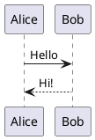

# PlantUML

用 PlantUML 文字畫 UML 等圖，預設在本機算繪，也可以選擇用 PlantUML 伺服器。

- 寫一個 `plantuml` 程式碼區塊，下方就會畫出來；點進區塊可以再看到並修改原始碼。
- 在語言後面寫 `height=400` 可以設定圖的高度。
- 匯出 HTML、PDF、Word 時，圖會以圖片放進去。
- 設定 › 擴充功能 › 外掛 › PlantUML › 算繪方式：本機（預設，內容不離開電腦）或 PlantUML 伺服器。

## 範例

