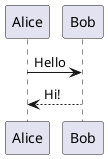

# PlantUML

在代码块里用 PlantUML 文本画 UML 等图，默认在本机绘制，也可以选择交给 PlantUML 服务器。

写一个语言为 `plantuml` 的代码块，在里面写 PlantUML 文本（从 `@startuml` 到 `@enduml`）。代码块下方会画出图；点进代码块可以再次查看和修改源码。

- 时序图、类图、活动图、状态图、组件图等 PlantUML 图，都由编译后在 Textus 里运行的 PlantUML 本身绘制。
- 在语言后面写 `height=400` 可以设置图的高度（单位像素）。
- 在本机绘制时，图会跟随主题的浅色或深色外观。
- 文本画不出来时，代码块里会说明哪里出了问题。
- 导出 HTML、PDF、Word 时，图会作为图片放进去。

**设置 › 扩展 › 插件 › PlantUML › 渲染方式** 决定在哪里画图：

- **本机**（默认）：内容不会离开电脑。在本机画图会多占一些内存。
- **PlantUML 服务器**：每张图的文本会发给 plantuml.com，由它来画，不额外占内存。

插件只申请访问 `www.plantuml.com` 的网络权限，而且只在你选择 PlantUML 服务器时才用。

## 示例

## 更新日志

- **0.2.7** - Its page no longer says which devices it runs on: the store shows that. It no longer gives a figure for the memory drawing on your computer takes. Its page receives Textus's messages by the API's current name.
- **0.2.6** - Its package lists the libraries it carries, with their licenses.
- **0.2.5** - A chart drawn while its block was folded (a phone) fits once the block opens, instead of keeping its old size.
- **0.2.4** - `!theme` works; no empty gap in a narrow column; server mode shows PlantUML's own error and draws dark in dark themes.
- **0.2.3** - Shorter help and empty-state text.
- **0.2.2** - Its page now says in one sentence what it does, what it can do, and what changed in each version.
- **0.2.1** - Ships the updated shared chart page; diagrams are drawn as before.
- **0.2.0** - Ships the shared chart page that takes its colors from the theme. Needs Textus 1.3.2.
- **0.1.3** - Uses the theme's document text color and footnote size under their Textus 1.3 names.
- **0.1.2** - Drawings from the PlantUML server show again; says that drawing on your computer takes about 100 MB more memory.
- **0.1.0-0.1.1** - First versions: `plantuml` code blocks drawn on your computer or by the PlantUML server, `height=`, and exports as a picture.
