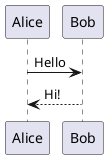

# PlantUML

在代码块里用 PlantUML 文本画 UML 等图，默认在本机绘制，也可以选择交给 PlantUML 服务器。

写一个语言为 `plantuml` 的代码块，在里面写 PlantUML 文本（从 `@startuml` 到 `@enduml`）。代码块下方会画出图；点进代码块可以再次查看和修改源码。

- 时序图、类图、活动图、状态图、组件图等 PlantUML 图，都由编译后在 Textus 里运行的 PlantUML 本身绘制。
- 在语言后面写 `height=400` 可以设置图的高度（单位像素）。
- 在本机绘制时，图会跟随主题的浅色或深色外观。
- 文本画不出来时，代码块里会说明哪里出了问题。
- 导出 HTML、PDF、Word 时，图会作为图片放进去。

**设置 › 扩展 › 插件 › PlantUML › 渲染方式** 决定在哪里画图：

- **本机**（默认）：内容不会离开电脑。在本机画图约多占 100 MB 内存。
- **PlantUML 服务器**：每张图的文本会发给 plantuml.com，由它来画，不额外占内存。

插件只申请访问 `www.plantuml.com` 的网络权限，而且只在你选择 PlantUML 服务器时才用。电脑、iPhone 和 iPad 上都能用。

## 示例

## 更新日志

- **0.2.2** - 介绍页重写：一句话说明它做什么，再讲它能做的事，并列出每个版本的更新。
- **0.2.1** - 打包更新后的公共图表页面，绘图效果不变。
- **0.2.0** - 打包从主题取色的公共图表页面。需要 Textus 1.3.2。
- **0.1.3** - 按 Textus 1.3 的新名称读取主题的正文文字颜色和脚注字号。
- **0.1.2** - PlantUML 服务器画的图重新能显示；说明在本机画图约多占 100 MB 内存。
- **0.1.0-0.1.1** - 最初的版本：在本机或由 PlantUML 服务器绘制 `plantuml` 代码块，支持 `height=`，导出时作为图片。
