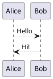

# PlantUML

用 PlantUML 文本画 UML 等图，默认在本机渲染，也可以选择用 PlantUML 服务器。

- 写一个 `plantuml` 代码块，下方就会画出来；点进代码块可以再看到并修改源码。
- 在语言后面写 `height=400` 可以设置图的高度。
- 导出 HTML、PDF、Word 时，图会作为图片放进去。
- 设置 › 插件 › PlantUML › 渲染方式：本机（默认，内容不离开电脑）或 PlantUML 服务器。

## 示例

